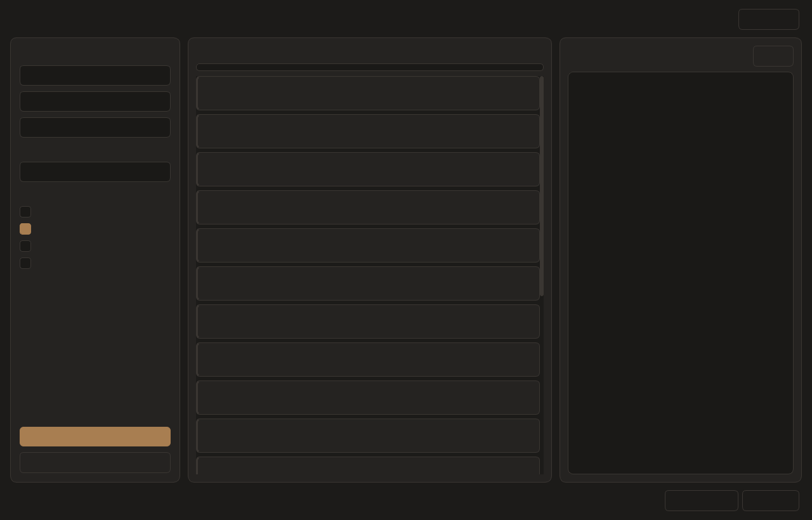

# tb-verify — 产品出厂自动检测

图形界面和命令行共用产品配置、检测逻辑与报告模板，输出 Markdown / HTML 报告。

> 原名 `TianracerT110_Test_SoftWare_RDK_UI`。2026-11-03 起改为多产品架构：
> 一套代码服务多个产品，产品差异全部放在 `products/<产品id>/` 里，
> **加新产品不需要改任何 .py 文件**。

输入车辆 IP，点击「开始检测」，按产品配置档自动执行检测，报告自动归档。

> 检测项数由产品决定 —— 当前默认产品 `tianracer_t110_rdk` 是 19 项，
> 换成别的产品会自动跟着变。
命令行用法见 [docs/CLI.md](docs/CLI.md)。
开发约束和验证入口见 [AGENTS.md](AGENTS.md) 与[开发指南](docs/development.md)。



## 快速开始

```bash
# 1. 安装依赖（只需一次）
pip install -r requirements.txt

# 2. 启动
python app.py

# 或运行命令行版（只需安装 requirements-cli.txt 中的依赖）
python run.py
```

已发布的历史 Windows GUI 包见 [Release 页面](https://github.com/tianbot/tb-verify/releases)。当前合并后的 GUI／CLI 版本尚未发布；发布及校验流程见 [RELEASE.md](RELEASE.md)。

## 连接方式（有线 / 无线）

左侧顶部是两个分段按钮，切换后界面会跟着变。

### 有线模式（USB-C 直连）

适用于车在一个陌生环境、还没连 WiFi 的情况。点「开始检测」后软件自动：

```
1. 确认上位机 192.168.128.10 可达
      └ 不可达 → 提示检查线缆/车机电源，不改任何车辆配置
2. 读车上 WiFi 状态
      └ 已连在与电脑相同的网络 → 跳过重连（快且不会让车掉线）
3. 需要重连时：扫描 → 匹配 SSID → 需要密码则弹窗
      └ 匹配策略：先精确匹配；电脑在 TianbotOffice-5G、
        车在 TianbotOffice 时，按去掉频段后缀视为同一网络
4. 读 WiFi IP，提示你拔掉 USB 线
5. 检测到拔线（192.168.128.10 不可达）→ 用 WiFi IP 开始检测
```

> **为什么非要拔线**：不拔线就算通过，交付后客户远程连不上很难排查。
> 拔线后仍能连上，才说明无线真的可用。

有线模式下车不用填 IP —— 地址是固定的。

### 无线模式

车已经在 WiFi 上时用这个。直接填它的 IP 开始检测。

## 界面说明

```
┌──────────────┬─────────────────────┬──────────────┐
│  左侧配置     │  中间检测项仪表盘     │  右侧运行日志  │
│              │                     │              │
│ · 车辆 IP     │  每项一张卡片         │  实时滚动     │
│ · 用户名密码   │  颜色区分状态         │              │
│ · 运行方式     │  顶部进度条           │              │
│ · 运动选项     │                     │              │
│              │                     │              │
│ [开始检测]     │                     │              │
│ [停止]        │                     │              │
└──────────────┴─────────────────────┴──────────────┘
        底部：判定结果 + 查看报告 + 打开报告目录 + 人工检测项 + 清理使用记录
```

### 底部按钮

| 按钮 | 作用 |
|---|---|
| 打开报告目录 | 用资源管理器打开本次报告所在目录 |
| 查看报告 | 用默认浏览器打开 report.html |
| **人工检测项** | 打开 report.html 并定位到打勾区 |
| **清理使用记录** | 删除车上 ROS 日志 / .viminfo（二次确认，默认保留命令历史） |

> **下载 PDF 不在软件里，在报告里**。打开报告后顶部有「下载 PDF 检测报告」。
> 这样勾选状态天然带进 PDF —— 软件内置渲染是独立环境，拿不到浏览器里勾的东西。

### 在报告里做人工确认

打开 `report.html` 后可以做三件事：

1. **确认接受告警项**：结果汇总表里，WARN / SKIP 行右侧有「确认」框。
   勾选表示「这条我判断为可接受」，该行转绿并计入通过数。
   失败项没有确认框 —— 出问题就是出问题，不能靠勾选覆盖。
2. **现场人工项打勾**：9 条，含「车与遥控器是否匹配」「车是否跑得直」。
3. **下载 PDF**：顶部按钮，走浏览器打印，勾选状态一并带入。

勾选状态存在本机浏览器，关掉再开还在。所有勾选动作都记进报告末尾的「复核记录」。

> 程序自己**不会**把黄条变绿。它只报事实；能不能接受是人的判断。

### 状态颜色

| 颜色 | 含义 |
|---|---|
| 绿 | 通过 |
| 黄 | 告警（需人工判断是否可接受） |
| 青 | **待验证**：本阶段测了，但结论要等落地段 |
| 红 | 失败（不可通过勾选覆盖） |
| 灰 | 跳过 / 未验证 |

告警项是否影响出货，由人到报告里逐条判断。勾了「确认」就转绿并计入通过，
摘要里保留原始事实和「（已人工确认接受）」字样，事后可追溯。

### 主题

右上角「切换主题」在深色/浅色间切换。深色为默认，与 logo 金棕色同色系。

## 运行方式（两选一）

- **程序自动启停 ROS**：程序自己 `roslaunch` / `pkill`，测完清理干净。适合单机测试。
- **检测已运行的 ROS**：你已经在车上起好 `bringup`，程序只做检查。适合排查现场问题。

## 运动测试

**默认全部关闭。** 三个勾选项是包含关系：

| 勾选 | 实际执行 |
|---|---|
| 都不勾 | 第 18 项记为「未验证」 |
| 允许微动 2 cm | 微脉冲（约 1.5 cm） |
| 执行完整运动测试 | 微脉冲 + 架空段 + 落地段 |

> **完整运动测试自动包含微脉冲**——勾了它，微动脉冲一定会做。
> 两个选项不是并列的，界面上也按包含关系处理。

运动前会弹窗确认安全条件。落地段开始前会弹一个**非模态**提示，
你可以先把车放到地面再点「继续落地段」，期间界面仍可操作。

### 落地段会转圈，需要空间

落地段除了前进/后退/转向，还会 **左转、右转各转一整圈**做航向互校：

```
转一整圈 → 比对两个独立来源的航向累积
   · 里程计推算的航向（靠编码器 + 转向几何）
   · IMU 陀螺仪实测的航向（直接测量，不打滑）
两者应该都接近 360°。偏差 ≤ 15° 合格，≤ 30° 告警，再大判失败。
```

方向控制用 IMU（直接测量），里程计只作对照——这样两者才是独立来源。

> **空间要求：约 2.5 m × 2.5 m 开阔平地**，周围无人无障碍。
> 单方向约 35~45 秒，左右各一次。
>
> **实际耗时**：落地段总共会让车持续运动 **最长约 4 分钟**
> （左转一圈 + 右转一圈，单圈上限 90 秒，探针硬上限 120 秒）。
> 这比微脉冲（1.5 cm）长得多，按「开始检测」前请确认场地和人手。

### 为什么 IMU / 里程计会出现「待验证」

架空段只能验证「有数据、频率对、静止不漂」，**证明不了走起来以后航向准不准**。
所以完整运动测试时，这两项在架空段结束后标记为**待验证（青色）**，
不是直接标绿：

```
架空段测完 → 待验证 ⏳
     ↓ 落地转圈互校
互校通过   → 通过 ✅
没做/未通过 → 保持待验证，计入未验证比例（不能交付）
```

不做运动测试时，这两项按频率与静态指标判 PASS，但摘要里会注明
「航向精度未验证」——不假装验证过。

### 停止按钮

点击后**立即发生三件事**：

1. **通知探针自行停车** —— 落地转圈时探针以 20 Hz 持续发指令，
   光发零速会在 50 ms 内被覆盖。所以先创建 `/tmp/tt_spin_abort`
   让探针自己退出，再发零速。
2. **马上发零速** —— 用独立的 SSH 连接发 `ackermann_cmd {speed:0, steer:0}`，
   不依赖正在阻塞的检测通道
3. **置取消标志** —— 运动段的每一段之前都检查，剩余段不再下发

然后：

4. 当前正在跑的那一段会自然跑完（最多 3 秒，就是该段时长）
5. `finally` 里清理车上的 `roslaunch`
5. 报告仍会生成，标注「用户手动停止」

按钮**不会变灰**。如果发现车还在动，可以再点一次重新发停车指令。
零速发送失败时会弹框提示你用遥控器接管。

> 为什么不能「立即杀掉线程」：那样会跳过 `finally`，
> 留下车上未清理的 roslaunch 和可能还在转的电机。

### 关闭窗口

测试进行中关闭窗口会弹确认框。确认后会先发停车、等线程结束、清理 ROS，
**最多等 180 秒**。

如果 180 秒还没结束，**窗口不会关闭**——因为关了就看不到日志、无法再停止，
而车可能还在动。此时会弹框告诉你用遥控器接管，以及在车上如何手动清理。

## 报告

与命令行版**格式完全一致**，写到：

```
test records/<IP>_<YYYYMMDD_HHMMSS>/
├── report.md      # Markdown
├── report.html    # 双击用浏览器打开
└── raw.log        # 每条命令的原始输入输出
```

- 程序版（`python app.py`）：报告在**工程目录的上一级**
- 打包版（exe）：报告在 **exe 同目录**

界面底部有「查看报告」「打开报告目录」「人工检测项」「清理使用记录」四个按钮，
最下方是「下载 PDF 检测报告」。

### 导出 PDF

在报告顶部点「下载 PDF 检测报告」，**直接下载一个 .pdf 文件**，不再跳打印窗口。

原理：`html2canvas` 把整份报告画成图片，`jsPDF` 再按 A4 切成多页。
中文由浏览器自己的字体渲染进图片，不需要嵌字体文件。

PDF 里保留：

- 状态颜色（绿/黄/红）
- 人工确认的勾选状态（导出时用 ✅ / ☐ 文字符号）
- 现场人工项的勾选
- 卡片和表格尽量不跨页断开

> 报告目录里会多出 `jspdf.umd.min.js` 和 `html2canvas.min.js` 两个文件（共约 550 KB）。
> 这两个库跟着报告走，所以整个报告文件夹可以压缩发人，离线也能导出 PDF。
>
> 若想用浏览器原生方式（文字可选中、体积更小），仍可用「直接打印」→ 另存为 PDF。

### 使用痕迹清理

**默认不清理。** 测试跑完不会删车上任何文件。

> 例外：**有线模式会在车上创建/更新一个 WiFi 连接配置**
> （`/etc/NetworkManager/system-connections/<SSID>`，含密码，默认自动连接）。
> 这是让车联网的必要动作，不是测试副作用，但确实改动了车辆。
> 需要清掉时在车机执行 `nmcli connection delete <SSID>`。
> 其余所有检测项只读。

需要清理时点「清理使用记录」按钮（二次确认）。会删除：

- `~/.ros/log` 下的 ROS 日志
- `~/.viminfo`

**默认保留 `~/.bash_history`** —— 命令历史是现场排查的依据，不是「痕迹」。
确实要清掉，把 `products/<产品id>/baseline.yaml` 里 `traces.keep_bash_history` 改成 `false`。

> 2026-11-03 审查后的调整：原实现默认在测试后自动删痕迹，
> 违反「绝不修改车辆持久配置」的约束，且用户不知情时会丢排查线索。

## 判定逻辑

程序看的是**未验证比例**，不是通过率。判定顺序（前面的优先）：

1. **中途停止** → 不具备交付条件（红色）
2. **任何 FAIL** → 不具备交付条件
3. **致命项停在「待落地验证」** → 不具备交付条件
4. **未验证比例**（SKIP + 待落地验证）超过 20% → 不具备交付条件
5. 有未验证项但不超过 20% → 可交付，但报告列出是哪些
6. 全 PASS → 具备交付条件

### 关于「待落地验证」（青色）

IMU 和里程计的**频率与静态指标**在架空段就能测，
但**航向精度**必须落地转一整圈、与里程计比对才知道。

所以完整运动测试时，这两项在架空段结束后标为**待落地验证**，不是通过：

```
架空段测完  →  待落地验证 ⏳
    ↓ 落地左右各转一圈互校
互校通过    →  通过 ✅
没做/没通过  →  保持待验证，计入未验证比例
```

IMU 与里程计在配置里都是**致命项**，所以它们停在待验证状态时，
整车判「不具备交付条件（致命项未完成落地互校）」。

> **这意味着：不勾「完整运动测试」时，结论一定是不可交付。**
> 这是有意的 —— 航向精度从未验证过的车不该判合格。
> 场地不允许落地转圈时，在报告 HTML 里勾选「确认接受」表示这是
> 显式的人工判断；但**程序自动判定仍然保持红色**，两者并存。

报告同时显示两个判定，互不覆盖：

- **程序自动判定** — 基于原始数据，不受人工勾选影响
- **人工复核后判定** — 勾选确认接受后出现，写明接受了多少项

## 目录结构

```
app.py              图形界面入口
run.py              命令行入口
build.py            图形界面打包
build_cli.py        命令行打包
ui/                 界面：主窗口、卡片、主题
core/               SSH、ROS 生命周期、主流程、判定
checks/             检测项模块（按产品配置挑用）
probes/             下发到车辆 /tmp 执行的测量脚本
report/             报告模板（Jinja2）
products/           产品配置档（每个产品一个目录，见下）
  _template/        新产品模板：复制后改值即可
  tianracer_t110_rdk/
    profile.yaml    产品定义：ROS 话题、工作空间、检测项清单
    baseline.yaml   判定阈值
assets/app.ico      exe 图标
tests/              自动化测试
tools/              图标生成与检查脚本
```

## 新增一个产品

不需要改代码。步骤：

```bash
cp -r products/_template products/你的产品id
```

然后编辑两份文件：

| 文件 | 改什么 |
|---|---|
| `profile.yaml` | 产品名、ROS 工作空间、启动包、话题名、检测项清单 |
| `baseline.yaml` | 判定阈值 |

改完直接启动，左侧/标题会自动显示新产品，检测项按 `checks.items` 执行。

**校验很严格**：少字段、话题名写错、检测项顺序不是 static→runtime→motion，
加载时都会报错并指出**哪个文件哪个字段**，不会用默认值糊过去。
这是刻意的 —— 静默兜底会让报告看起来正常，实际判的是另一套标准。

## 修改阈值

所有阈值集中在 `products/<产品id>/baseline.yaml`，带注释。
**换产品就是换目录**：每个产品有自己的一份阈值，互不影响。
改完直接重启程序，不用改代码。

## 打包 exe

```bash
pip install pyinstaller
python build.py
python build_cli.py
```

Windows 产物分别为 `dist/tb-verify-ui.exe` 和 `dist/tb-verify-cli.exe`。

界面版打包后运行 `--self-check` 检查资源和报告模板；命令行版运行 `--help` 冒烟检查。

> PyInstaller 产物偶尔被杀软误报，需加信任。

## 与命令行版的关系

两个入口共用 `core/`、`checks/`、`probes/`、`report/` 和 `products/`。

| | 命令行版 | 图形界面版 |
|---|---|---|
| 入口 | `run.py` | `app.py` |
| 适用 | 脚本化、远程、批量 | 现场操作、演示 |
| 依赖 | paramiko, jinja2, pyyaml | 上述 + PyQt5 |

修改共享逻辑时应验证两个入口；两个版本仍分别打包。

## 已知限制

- 只支持单台车
- 建图质量、导航到点、遥控手感需人工验证
- Windows 可分别打包界面版和命令行版；其他平台的打包产物未在此项目中验证
- 停止按钮会让车立刻停，但当前检测项会标记为「用户中断」而非完成
