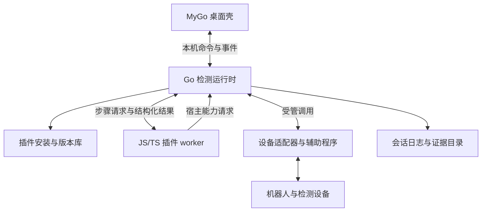

# 多机器人插件化检测平台技术方案

本方案面向通信协议和检测流程不同的机器人。MyGo 提供统一桌面入口，产品插件描述检测内容，独立运行时执行并记录每轮检测。新增产品的主要交付物是插件包；需要宿主新能力时，明确升级运行时的范围。

方向由 [ADR-0006](../adr/0006-mygo-plugin-platform.md) 确认，本文为设计与实施基线，状态为 **尚未实现、尚未验收**。仓库 `main` 当前仍是 Python GUI/CLI，既有用法见[项目说明](../../README.md)。NSH 探索不纳入新平台成本或实施依赖。

## 文档与参考范围

| 文档 | 回答的问题 |
| --- | --- |
| 本文 | 组件如何分工、会话如何执行、如何分阶段交付 |
| [插件接口 v1](plugin-api-v1.md) | 插件包、导出函数、宿主 API、IPC、状态和结果如何约定 |
| [UI/UX 方案](mygo-ui-ux.md) | 怎样借鉴参考项目并形成可操作的检测界面 |

参考基线为 [mygo-music@8a366b7](https://github.com/egoist/mygo-music/tree/8a366b7cc3363349d5eefdca448fc16f440a3dee)。关键实现包括：

- [插件加载与 VM](https://github.com/egoist/mygo-music/blob/8a366b7cc3363349d5eefdca448fc16f440a3dee/internal/plugin/plugin.go)：声明文件、JS/TS 编译、导出能力、独立 VM。
- [宿主与辅助进程](https://github.com/egoist/mygo-music/blob/8a366b7cc3363349d5eefdca448fc16f440a3dee/internal/plugin/host.go)：按权限调用宿主、标准输入输出通信。
- [安装流程](https://github.com/egoist/mygo-music/blob/8a366b7cc3363349d5eefdca448fc16f440a3dee/internal/plugin/install.go)：先检查安装包，再替换代码，保留插件数据。
- [领域和页面模型](https://github.com/egoist/mygo-music/blob/8a366b7cc3363349d5eefdca448fc16f440a3dee/internal/music/music.go)：统一业务对象，由宿主渲染。

参考工程的插件 VM 在应用进程内，普通调用默认 30 秒超时，异步等待超时后可能继续运行，更新会关闭旧实例。这里采用不同的检测会话与更新约定。参考项目通过的音乐插件测试只说明该提交的相关行为，不证明本方案可运行。

参考版本的依赖包括 MyGo `v0.8.1-0.20261106182104-487bc3496d89`、MoeJS `v0.1.0-alpha.11`、Go `1.27.3`，仅作为 P0 评估起点，不构成本项目已锁定的依赖。`mygo-music` 的源码许可为 AGPL-3.0，直接复用代码、图标或资源前记录来源与许可处理；首轮文档没有复制其源码或资源。

## 产品目标与首版范围

平台应支持同一桌面程序安装不同机器人插件。插件可以组合已有检测能力，也可以交付新设备适配器；连接方式允许 SSH/ROS、串口、HTTP、CAN 或厂商 SDK，实际支持清单由适配器及其平台验证结果决定。

首版聚焦一个工作站、一轮活动检测和一台被测设备，可读取历史报告。多设备并行、远程调度服务、公开插件市场、任意插件 UI 代码、云端账号和自动升级暂不实施。一个产品插件可包含多个型号和基线，但每轮只能选择一组明确的产品与硬件修订。

两种代表性产品用于验证扩展能力：T110 类 SSH/ROS 移动机器人，以及协议和流程显著不同的第二类机器人。第二类的具体型号、SDK、实物和基线尚未确定，P0 必须形成可获取性记录；替身可先验证协议契约，不能代替第二类产品验收。

产品接入成功的标准是检测流程、结果和异常路径成立。只增加菜单、加载脚本或演示几个返回值不算产品接入完成。

## 组件和进程边界



| 组件 | 拥有的数据与职责 | 不承担的业务 |
| --- | --- | --- |
| MyGo 壳 | 导航、表单、用户输入、会话视图、原生文件选择、报告查看 | 产品判定、SSH 命令、运动调度、独立推断检测状态 |
| Go 运行时 | 插件兼容性、计划校验、状态机、资源租约、能力调用、停止、持久记录、自动结论 | 型号专属算法和页面布局代码 |
| 插件 worker | 产品定义、计划生成、专属采集解释与单项判定、页面描述 | 自行授予权限、改写会话历史、决定整机放行 |
| 适配器/辅助程序 | 协议、SDK、采集、设备身份、停止与反馈 | GUI、产品包安装、人工复核 |
| 设备侧保护 | 动作时限、失联处置、停止条件及可观察状态 | 依赖桌面窗口持续正常运行才停机 |

GUI 启动本机运行时，运行时创建 worker。每轮使用独立 worker，VM 不承载跨轮设备状态；平台 MVP 限制一轮活动会话。运行时和 worker 可以由同一个安装包里的程序以内部模式启动，不提供面向操作员的独立 CLI。

UI 与运行时断开后停止派发新的检测步骤，运行时进入取消和收尾路径；重新打开 UI 可附着并读取现状。运行时退出或失联时，适配器按控制租约失效执行停止策略，设备侧还需独立截止保护。任一环节不能确认安全状态时保留 `RECOVERY_REQUIRED`，不释放用于阻止再次动作的恢复记录。

纯只读适配器可作为运行时内部模块；运动和持续控制必须通过受管的独立辅助进程，由它监控运行时心跳及管道关闭，执行超时停止。进程与设备两侧的保护分别验证，结束辅助进程不能替代设备停止。设备租约协调本平台实例，不能排除旧工具或其他控制器的竞争；实车开始前还需确认控制权，无法确认时禁止动作。

进程隔离用于故障隔离，首版按经审核的内部插件运行，不宣称具备操作系统沙箱。原生辅助程序具有用户权限，脚本权限检查不能限制它的所有行为。插件不得通过通用 shell、任意 `spawn` 或任意网络连接绕过设备能力层；新增原生能力需连同辅助程序实现和设备侧行为一起复核。

## 产品与检测能力如何扩展

产品插件负责产品定义、参数 schema、基线、检测清单、步骤依赖、风险条件和操作说明。所有设备操作经运行时派发到声明的能力。脚本只能获得本轮绑定设备的句柄，凭据由运行时使用；不能用一个产品的确认信息操作另一台设备。

通信协议与设备语义分别建模。`serial`、`ssh` 表示传输能力；`drive_base`、`joint_group`、`camera` 表示设备操作能力。两种底盘即使都使用 ROS，也可能有不同的转向、停止和反馈规则，适配器必须明确声明动作语义。

| 接入变化 | 预期修改 |
| --- | --- |
| 同类设备调整阈值、话题、检测组合 | 产品包配置和基线 |
| 增加组合流程、解析或轻量判定 | 产品包 JS/TS 与契约测试 |
| 新协议、原生 SDK、设备接口 | 已版本化的适配器/辅助程序及平台产物 |
| 新的交互组件或安全原语 | 运行时或壳升级，插件声明最低能力要求 |

v1 的普通产品包自包含资源与所需脚本，调用运行时已有适配器，或携带明确的平台辅助程序。公共脚本在构建插件时合入包；运行时不在线安装 npm/pip 包，不解析任意跨插件依赖。辅助程序运行所需解释器、动态库和驱动必须在包声明及安装预检中可见。

复杂流程由脚本生成计划，计划使用受限结构表达依赖、前置条件和步骤参数；不实现可执行任意表达式的 YAML 语言。计划在执行前冻结。设备自检和能力探测作为计划内的只读步骤，不在加载插件或切换页面时隐式连接设备。

## 一轮检测的生命周期

1. 选择产品、插件版本和设备，校验平台与必需能力；只加载元数据不连接设备。
2. 填写连接信息和操作员信息，生成并校验检测计划，显示将执行的步骤与具体副作用。
3. 用户开始后创建独占会话目录、设备租约和配置快照，再执行连接及只读前置步骤。
4. 运行时按步骤依赖调度。需要启动 ROS、修改网络或运动的步骤，先校验本轮授权和最新设备状态；人工确认写入记录后才放行。
5. 每步保存原始证据和结果。产品插件给出单项判断，运行时校验缺项、证据、安全条件与结果完整性，再计算自动结论。
6. 正常或异常结束都进入收尾。停止状态、受管进程与报告是否完成分别记录；不能确认停止时转恢复流程。

会话状态、步骤状态、单项判断和自动交付结论分别保存，具体枚举见[接口契约](plugin-api-v1.md#状态与判定)。报告写完不表示设备停稳；用户点击停止也不立即把运行状态改成已停止。

### 取消、超时与恢复

每个步骤有总超时，能力调用有独立截止时间，二者由运行时计算剩余预算。超时或取消发生后关闭本轮步骤的正常写入资格，迟到输出只记为迟到证据；动作结果不明时不自动重试。控制通道与普通采集任务分开，取消和停止不能等待卡死的 JS 事件循环。

只读步骤可在计划声明的次数内重试，每次尝试保留独立编号和证据。运动、写配置、清理等有副作用的步骤默认不自动重试；重试前需要已证实的设备状态及新的明确操作。

恢复首先检查会话日志、设备身份和原版本，展示停止证据与缺口。适配器可执行已审核的安全停止与状态查询；不会自动续跑中断前的运动。需要新检测时创建新 `runId`，旧记录保持原状。

### 安全条件与执行权限

安全约束由运行时、适配器和产品包共同校验。运行时内置最低要求；产品可以收紧约束，不能通过配置降低最低要求。移动机器人至少校验电压有效性和时效、场地确认、控制租约、独立停止通道和设备侧截止保护。机械臂等产品定义对应的能量状态、限位和工作区条件，按产品本身的风险逐项验证。

每次危险操作使用一次性授权凭据，绑定 `runId`、设备身份、步骤、动作参数及有效期。更换设备、修改计划或安全条件失效后重新确认。实现必须能在 worker 不响应时阻止新动作，且在停止未确认时保留设备锁和恢复提示。

软件停止能力及证据不等同于认证急停或物理停稳。设备缺少必要的独立保护时，该运动能力不能启用；界面仅能保留只读检测和现场接管指引。

## 安装、更新与版本追溯

首版支持本地目录和 ZIP 安装。安装在临时目录中完成结构、路径、文件大小、哈希、API、平台与入口检查，检查通过后登记到版本库；安装检查只允许纯元数据/编译步骤，不执行设备代码。失败保留原可用版本。

插件内容以 `pluginId/version/contentDigest` 定位；同版本不同内容需拒绝覆盖并要求新版本。每轮固定产品包、辅助程序、适配器和输入基线的摘要。旧版只要被会话或恢复记录引用就保留；切换默认版本影响新会话，运行中的会话不热替换。用户删除插件时先检查活动会话和历史恢复引用。

生产来源与开发目录分开管理。生产插件包须有可核验的发布者签名或组织批准的内容摘要；v1 先使用组织提供的批准清单，清单更新是一项显式操作。开发包显示未验收状态，不参与出厂放行。哈希证明内容一致性，不能单独证明发布者身份。在线目录、撤销服务和自动更新在首版之后评估。

## 证据、报告和人工复核

运行时独占写入本轮目录；凭据保存在会话内存或系统凭据设施中，通过引用供适配器使用。普通配置、事件、插件存储及报告均不保存密码。导出前执行字段级过滤，适配器同时负责对原始输出中的敏感内容脱敏。

建议的新会话目录如下，名称属于设计约定，当前代码尚未生成：

```text
<报告根目录>/<runId>/
├── session.json           # 产品、设备标识、版本、计划摘要和完成状态
├── plan.json              # 冻结的检测计划
├── events.jsonl           # 带顺序号的持久事件
├── artifacts/             # 脱敏后的原始采集证据
├── results.json           # 单项结果、完整性和自动结论
├── reviews.jsonl          # 人工复核及撤销，追加保存
├── manifest.json          # 文件大小、摘要和格式版本
├── report.html
└── report.md
```

执行前写入动作意图，执行后写入确认与证据引用。危险操作必须先确认日志持久写入成功；磁盘满或写入失败时停止派发动作并进入安全收尾，无法持久化的新状态在 UI 明确提示。事件中的墙上时间用于展示，顺序以运行时单调递增的 `seq` 为准；时间戳不作为动作先后或幂等性的唯一依据。

结果快照先写入同目录临时文件，完成持久化后原子替换，再记录归档事件；事件日志恢复时识别并截断未完成的尾帧，不能猜测缺失结果。`reportDigest` 覆盖冻结输入、计划、结果和证据清单，不包含持续追加的复核日志。导出时为当时的报告与复核记录生成完整文件清单，既保留原结果引用，也能校验导出包的实际内容。

人工复核绑定报告摘要、单项和证据，追加操作者、时间与理由；不改写自动结果。首版操作员姓名是现场登记信息，不宣称完成身份认证。例外放行、认证身份和电子签名不在本次首版范围。

新平台为每个产品显式定义全部必检项及交付条件。只有必需步骤和证据完整、安全收尾完成、产品交付条件满足时才可能得到 `ELIGIBLE`。T110 继承 [ADR-0002](../adr/0002-ground-heading-verification.md) 的落地航向互校要求；不以其他产品不存在相同动作作为跳过理由。旧报告按原格式只读展示，不通过格式转换补出当时没有的证据。

## UI 与插件的协作

采用原生 MyGo UI，参考音乐应用的产品切换位置、导航结构、主体列表与详情、插件设置和底部常驻栏。界面消费运行时状态和插件的受限描述模型，错误信息、按钮可用性和恢复提示由稳定协议决定。设计细节及可视验收矩阵见 [UI/UX 方案](mygo-ui-ux.md)。

插件能声明表单、说明、测量值、图片、曲线和人工检查，但不能覆盖全局停止栏、主会话状态或人工复核规则。v1 先提供有限组件；新增组件属于壳协议升级，不让产品插件直接调用 MyGo 控件或执行任意页面脚本。

## 代码组织与交付

建议目录属于后续实现计划，本轮不创建可执行工程：

```text
desktop/                  # MyGo 壳与通用组件
runtime/                  # 会话、调度、插件管理、证据和 IPC
worker/                   # JS/TS 引擎封装及宿主 API 代理
protocol/                 # schema、消息类型、兼容测试夹具
plugin-sdk/               # TS 类型、打包工具、契约测试工具
adapters/                 # 审核过的设备能力及停止策略
product-plugins/           # 随项目维护的产品包源码
```

目录最终在 P0 固定，不复用现存构建缓存目录。生产插件可独立存放源码，统一按 SDK 打包。桌面安装包提供壳、运行时、worker 和基础适配器；设备驱动及厂商运行库需列明安装条件。Go 的交叉编译能力不替代原生 SDK 及各目标系统验收。

构建记录固定 Go、MyGo、脚本引擎、协议与 SDK 版本，禁止发布构建隐式使用 `latest`。壳、运行时和内置 worker 成组发布；产品包独立版本，但必须通过所声明协议版本的兼容测试。打包、签名、发布和旧版本停用分别执行相应授权流程。

## 分阶段实施与退出条件

以下阶段均为 **未开始**。每阶段提交实现、精确版本、测试输出和未验证项；作者检查与独立复核分开记录。通过文档检查只代表文档一致，不代表阶段完成。

| 阶段 | 交付物 | 通过条件 | 失败后的处理 |
| --- | --- | --- | --- |
| P0：契约与技术探针 | schema/类型、包校验样例、MyGo 原生 UI 样例、JS 引擎/IPC 小程序、第二类产品资料 | 三平台能构建与启动样例；TS、内存限制、死循环终止、进程退出与中文输入有证据；确认第二类设备和 SDK 的获取条件 | 引擎或 UI 阻碍按证据更换实现；不把探针当产品 |
| P1：替身检测闭环 | 独立运行时、worker、离线安装、表单、纯替身插件、事件和报告 | 不连接车辆即可完成计划→执行→确认→取消→报告；UI 重连、坏包、旧 API、worker 崩溃、磁盘写失败均有明确状态；冻结 v1 契约 | 修订协议并重跑契约夹具，未通过前不接运动 |
| P2：首个产品只读检测 | T110 插件、SSH/ROS 适配器、基线和旧行为对照 | 替身覆盖所有计划内只读项；获授权的实车采集能关联原始证据；缺数据/错误配置不通过；UI 无型号分支 | 缺项保留未验证，收窄产品支持清单 |
| P3：受控动作与恢复 | 运动能力、日志、设备租约、截止保护、恢复入口 | 失联、迟到响应、双击、窗口关闭、worker/runner 崩溃均完成故障注入；独立复核后在明确授权下完成实车停止与恢复测试 | 任一停止状态不明则禁用该动作，保留只读能力 |
| P4：异构产品扩展 | 第二类真实产品插件与 SDK 适配器、安装和兼容记录 | 两类设备的协议和流程确有差异；第二产品主要新增插件/适配器；通用壳不出现型号专属分支；实际产品基线经确认 | 发现抽象不足时修订能力接口，不能用第二个同构样例代替 |
| P5：三平台交付 | Windows/macOS/Linux 安装包、签名与来源记录、操作文档、验收记录 | 干净目标系统完成安装、中文输入、检测、取消、恢复、离线报告及插件升级/回退；逐产品逐平台列明实测覆盖；确认支持矩阵后评估切换 | 未验证组合明确标记不支持；保留当前工具入口 |

P2、P3 的实车步骤和 P5 发布不是本次文档任务的授权。P0/P1 可以使用完全本地的替身先行实施；涉及实际设备时须取得具体设备、操作和范围的明确授权。

### 每阶段必须保留的证据

实现者记录源码 SHA、平台/架构、依赖锁、插件摘要、测试场景、结果文件及缺口。独立复核者审查协议、完整 diff 和失败路径；现场负责人确认设备、场地、基线和实物行为。每个状态都写成实际完成程度，不用“测试通过”代替对目标环境的说明。

### 验证矩阵

| 范围 | 核心场景 |
| --- | --- |
| 插件契约 | 坏 schema、缺必需接口、未知能力/API、平台不匹配、非法路径、摘要冲突 |
| 状态与并发 | 重复 start/cancel、乱序/迟到消息、控制通道拥塞、设备租约竞争、重复确认 |
| 故障与恢复 | 脚本死循环、OOM、helper 挂起、断网、运行时退出、磁盘满、恢复记录损坏 |
| 判定与证据 | 无样本、无效数值、必需项漏报、证据错配、报告写入失败、人工记录独立 |
| 原生界面 | 两种主题、中文输入、键盘焦点、不同缩放、长列表、底部停止栏、原生目录选择 |
| 产品适配 | 每个产品的能力/阈值/动作含义、只读对照、授权后的真实动作和中断恢复 |

## 尚待实施前落实的事项

- 第二类机器人的具体型号、协议文档、SDK 许可、设备和现场基线，由产品负责人在 P0 落实。
- 三平台最低系统版本、驱动支持及签名条件，通过 P0/P5 目标机记录确定，参考项目的支持声明不能直接代入。
- 脚本引擎、生产包批准清单的管理者、凭据后端和原生 SDK 来源，由 P0 记录为明确选择；设备操作隔离和会话契约不因实现库更换而放宽。
- 本轮只写文档，不建立依赖、不移动现有代码、不执行设备操作，也不将任何阶段标记为已交付。
